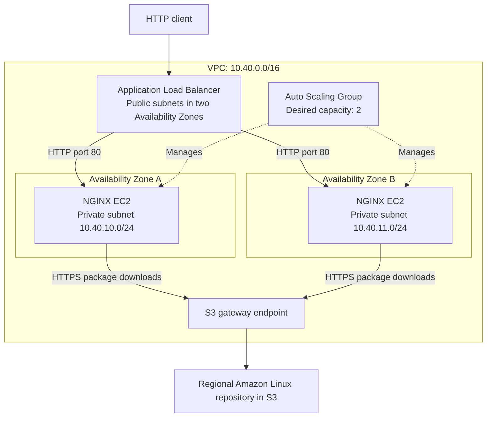

# Architecture and design decisions

## Overview

This project deploys a small NGINX web tier in AWS Sydney
(ap-southeast-2), using Terraform.

An internet-facing Application Load Balancer distributes HTTP traffic
to two EC2 instances in private subnets across two Availability Zones.
An Auto Scaling Group maintains a desired capacity of two instances
and automatically replaces unhealthy instances.

## Architecture diagram

The Auto Scaling arrows represent instance management, not application
traffic.

## Request flow

1. A client resolves the ALB's DNS name and connects using HTTP.
2. The ALB listener accepts requests on port 80.
3. The listener forwards requests to the web target group.
4. The ALB selects a healthy registered instance.
5. NGINX returns a static page containing the instance hostname.

The hostname makes it possible to identify which instance handled
a request.

The current deployment uses HTTP only. HTTPS would require a TLS
listener and an appropriate certificate.

## Network design

The VPC contains four subnets across two Availability Zones:

| Subnet | CIDR | Purpose |
| --- | --- | --- |
| Public A | 10.40.0.0/24 | ALB |
| Public B | 10.40.1.0/24 | ALB |
| Private A | 10.40.10.0/24 | NGINX instances |
| Private B | 10.40.11.0/24 | NGINX instances |

Public subnet route tables include a default route to an Internet
Gateway. Private subnet route tables have no default internet route.

EC2 instances have no public IP addresses. Package downloads use an
S3 gateway endpoint associated with the private route table.

This avoids a NAT Gateway for the current bootstrap requirements.
It does not provide general internet access to the private instances.

## Security boundaries

| Rule | Purpose |
| --- | --- |
| Internet → ALB, TCP 80 | Accept public HTTP requests |
| ALB → web security group, TCP 80 | Forward requests and health checks |
| Web → regional S3 prefix list, TCP 443 | Download bootstrap packages |

The web security group accepts HTTP only from the ALB security group.

The S3 endpoint policy restricts access to the regional Amazon Linux
repository bucket used by the bootstrap process.

Additional settings:

- Encrypted root EBS volumes.
- Instance Metadata Service v2 required.
- No inbound SSH access.
- No instance public IP addresses.
- No Systems Manager access configured.
- Project, Environment and ManagedBy tags.

## Instance configuration

A launch template defines the configuration used for new instances:

- A pinned Amazon Linux 2023 ARM64 AMI.
- t4g.micro instance type in the deployed test configuration.
- An encrypted 8 GiB gp3 root volume.
- Network and security-group settings.
- A startup script that installs and configures NGINX.

The startup script creates:

- A static page displaying the instance hostname.
- A /health endpoint.
- An NGINX configuration listening on port 80.

It validates the NGINX configuration, starts the service and checks
the local health endpoint.

The tested replacement completed bootstrap approximately 153 seconds
after boot. Installing packages at startup introduces a dependency on
repository availability and adds recovery time.

## Health checks and automatic replacement

The ALB checks /health using:

| Setting | Value |
| --- | --- |
| Interval | 5 seconds |
| Timeout | 2 seconds |
| Healthy threshold | 2 |
| Unhealthy threshold | 2 |
| Expected response | HTTP 200 |

The Auto Scaling Group uses ELB health checks, with a 300-second
startup grace period.

The ALB decides whether an instance can receive traffic. Auto Scaling
decides whether an instance needs replacing. These are separate
responsibilities: an instance can exist in the group before its
application is ready to serve requests.

The group normally maintains two instances. Its maximum capacity
allows a third instance during replacement or rolling updates.

## Recovery scope

Automatic instance replacement succeeded. 

## AWS and Azure comparison

The following services have similar responsibilities, but are not
identical replacements.

| AWS component | Closest Azure concept | Role in this project |
| --- | --- | --- |
| VPC | Virtual Network | Isolated network |
| Subnet | Subnet | Separate public and private placement |
| Availability Zone | Availability Zone | Separation between failure domains |
| EC2 instance | Azure Virtual Machine | Runs NGINX |
| Auto Scaling Group | Virtual Machine Scale Set | Maintains and replaces instances |
| Application Load Balancer | Application Gateway | HTTP-aware traffic distribution |
| Security group | Network Security Group | Controls permitted traffic |
| Launch template | VM Scale Set model | Defines new instance configuration |
| EBS volume | Managed Disk | Persistent block storage for the OS |
| User data and cloud-init | Custom data and cloud-init | Configures Linux during startup |

Important differences:

- AWS subnets belong to a specific Availability Zone. Azure subnets
  are not assigned to individual Availability Zones in the same way.
- An AWS Internet Gateway is attached to the VPC and referenced by
  routes. Azure does not require an equivalent separately attached
  Internet Gateway resource.
- An S3 gateway endpoint is closer in purpose to an Azure Storage
  service endpoint than a private endpoint. It does not create a
  private endpoint network interface.
- Azure VM Scale Set repair behaviour must be configured explicitly;
  deploying multiple VMs alone does not establish equivalent recovery
  behaviour.

## Why this design

The managed ALB and Auto Scaling Group provide traffic distribution,
health checks and automatic replacement without implementing a custom
proxy or instance-replacement controller.

Private instances limit direct inbound access. Two Availability Zones
provide separation between instance locations.

An S3 gateway endpoint supports the package-download requirement
without adding a NAT Gateway.

The design is operationally straightforward for this assessment, but
there is an unresolved requirements:

- The preliminary monthly estimate exceeds AUD 20.

## Cost and scope

The original design used t4g.nano. The test account rejected that size
under its Free Tier restrictions, so deployment used t4g.micro.

Verified Sydney rates give a fixed subtotal of AUD 68.33/month before
traffic and GST, assuming 730 hours and USD 1 = AUD 1.60. Illustrative
ALB usage scenarios total AUD 69.27–72.07 before other transfer charges.
These are usage assumptions, not a measured monthly bill or spending cap.
The cost report includes an Azure alternative with explicit sizing assumptions;
performance parity and deployment have not been validated.

See [cost assumptions](cost-estimate.md).

The current implementation is a demonstration rather than a
production-ready service. HTTPS, shared remote Terraform state and
additional operational monitoring are outside the implemented scope.
